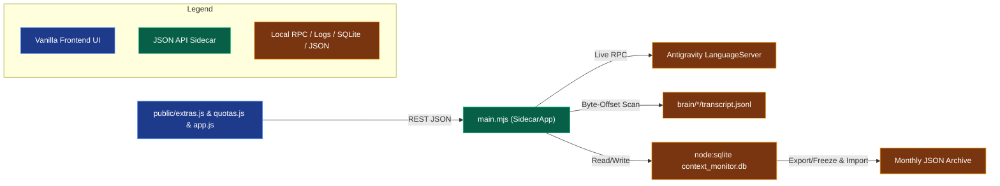

# Architecture & Roadmap

### [SUBSYSTEM: Lightweight-Sidecar-Core] | Aliases: architecture, data flow, sqlite, go migration
> **1-Line Summary:** Zero-dependency Node.js sidecar serving vanilla JS/CSS views over REST while persisting incremental byte-offset cursors, quota runway samples, custom prices, and frozen monthly archives in SQLite.

* **Backend Modules (`Code Anchors`):**
  * `sidecars/context_monitor/main.mjs :: getConversationsSnapshot` — `GetAllCascadeTrajectories` subagent/main detection and switcher feed.
  * `sidecars/context_monitor/main.mjs :: getBreakdownSnapshot` — `GetCascadeTrajectoryGeneratorMetadata` + `GetCascadeTrajectorySteps` -> `computeContextBreakdown`.
  * `sidecars/context_monitor/main.mjs :: getDiagnosticsSnapshot` — Active-chat `GetCascadeTrajectoryGeneratorMetadata` + `config.json` -> `analyzeActiveDiagnostics` (`/api/diagnostics`).
  * `sidecars/context_monitor/main.mjs :: getScopeSnapshot` — Incremental sync + `queryScopeRows` + `calculateScopeCosts` + `buildProjectAndChatBreakdowns` + `getCostPrefs`.
  * `sidecars/context_monitor/main.mjs :: getAccountsSnapshot` — Multi-account quota snapshot + cumulative per-account/all-model attribution + `extractPerModelQuotas` (`/api/accounts`).
  * `sidecars/context_monitor/main.mjs :: getQuotasSnapshot` — `RetrieveUserQuotaSummary` + `GetUserStatus` + `extractAICredits` + `recordQuotaSamplesAndComputeRunway` (with BYOK `isCustomOrByokModel` isolation).
  * `sidecars/context_monitor/diagnostics.mjs :: analyzeActiveDiagnostics` & `readLocalOrchestratorConfig` — Active-chat Orchestrator vs Executor role split & cold-cache resets, retry/error waste, and Model DNA.
  * `sidecars/context_monitor/quotas.mjs :: isCustomOrByokModel` — Detects BYOK/custom/local models without false positives on Antigravity `Orchestrator (Custom)`.
  * `sidecars/context_monitor/lib.mjs :: parseTranscriptText` & `enrichSummaryWithSpeed` — Transcript step aggregation, compaction drop detection, and `nativeLimitTokens` (`1M` vs `512K`).
  * `sidecars/context_monitor/accounts.mjs :: extractActiveAccountSnapshot` & `extractPerModelQuotas` — Signed-in account metadata, pool reset timers, per-model `5h/7d` windows, and one-time legacy seed.
  * `sidecars/context_monitor/db.mjs :: scanTranscriptIncremental` — Byte-offset `transcript.jsonl` incremental reader with truncation recovery, account token attribution, and frozen-month skip (`archived = 1`).
  * `sidecars/context_monitor/db.mjs :: buildProjectAndChatBreakdowns` & `queryHeatmapSql` — Project/conversation tree cost rollup, SQLite `cost_prefs`, and heatmap analytics (tokens/USD, streaks, App vs CLI filter).
  * `sidecars/context_monitor/db.mjs :: exportMonthArchive` & `backfillLegacyAccountModelsOnce` — Exports/freezes monthly JSON bundles and backfills per-model legacy account seeds without double-counting.
  * `sidecars/context_monitor/db.mjs :: getUiPrefs` & `saveUiPrefs` & `resolveUiPrefsPath` — Persists section visibility, language, active tab, cost scope, and lock-main state in SQLite `kv` (`ui_prefs_v1`) mirrored atomically to a durable cross-install JSON file (`%APPDATA%\context-monitor\ui-prefs.json` / XDG config).
  * `sidecars/context_monitor/main.mjs :: /ui-prefs.js` & `/api/ui-prefs` — Synchronously bootstraps `globalThis.__CM_UI_PREFS__` before UI render and handles authenticated coalesced preference updates from `public/prefs.js :: CM_PREFS`.
  * `sidecars/context_monitor/pricing.mjs :: calculateScopeCosts` — Published API rate attribution + user custom overrides.
  * `sidecars/context_monitor/breakdown.mjs :: computeContextBreakdown` — 9-category prompt context classification + Top 5 consumer extraction.

### [DECISION: Node-Sqlite-Now-Go-Backend-Future] | Aliases: go migration, ram optimization, roadmap
> **1-Line Summary:** `[DECIDED BY: HUMAN]` Keep the lightweight zero-dependency Node.js (`node:sqlite`) backend for immediate Antigravity portability (~80–95 MB RSS), with a clean option to swap the HTTP backend to a compiled Go binary (~8–18 MB RSS) in the future without altering `public/`.

* **Rationale:** Every UI module (`public/*.js`, `public/styles.css`, `public/index.html`) interacts exclusively through documented JSON endpoints (`/api/context`, `/api/quotas`, `/api/accounts`, `/api/diagnostics`, `/api/scope`, `/api/cost-prefs`, `/api/ui-prefs`, `/ui-prefs.js`, `/api/breakdown`, `/api/conversations`, `/api/pricing`, `/api/archive/export`, `/api/archive/import`, `/api/heatmap`, `/api/heatmap/analytics`). Replacing `main.mjs` + `.mjs` libraries with a single Go executable later requires zero frontend or `app.asar` changes.
* **Links:** `[FEATURE: Parity-Inventory-Ledger]` (`docs/PORTING_MATRIX.md`)
* **Verified By:** `sidecars/context_monitor/test/features.test.mjs :: phase 4 active-chat orchestrator split, retry/error waste, model dna, config reader, and byok isolation`
